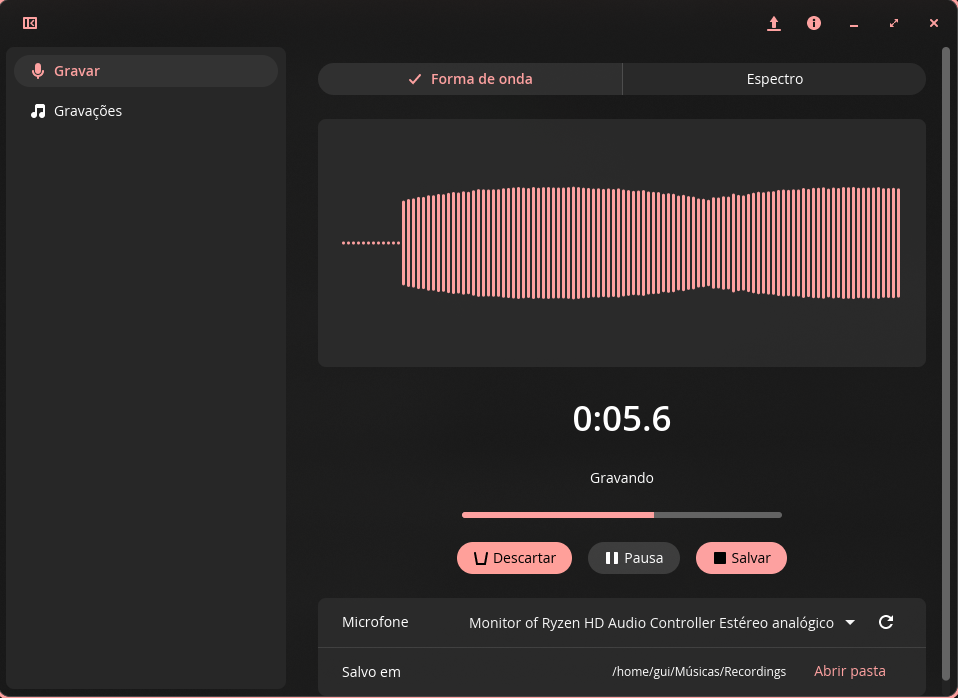
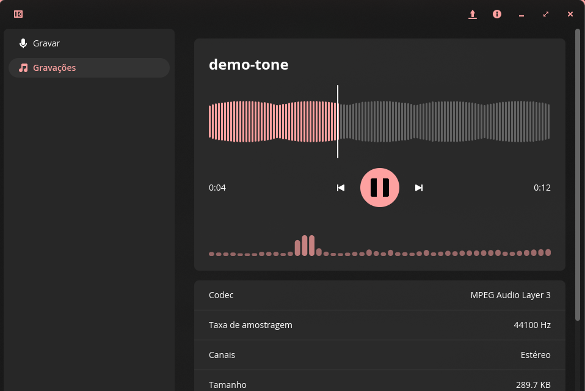

# Gravador de som para o COSMIC™

Um gravador de som simples para o ambiente COSMIC™, feito com a libcosmic: grava do microfone (ou do
que o computador está tocando) mostrando o som enquanto grava, e abre e toca arquivos de
áudio com a forma de onda inteira, o espectro e os detalhes do arquivo.

| Gravar | Ouvir |
| --- | --- |
|  |  |

## O que faz

- **Grava** de qualquer entrada: os microfones e também os *monitores* das saídas, para gravar
  o som do computador. Pausar, retomar, salvar ou descartar. Grava em WAV 16 bits, na taxa e
  nos canais da entrada, em `Músicas/Recordings` (a pasta de música do sistema).
- **Mostra o som** enquanto grava: forma de onda rolando, ou espectro (48 bandas de 40 Hz a
  16 kHz, em escala logarítmica), e um medidor de nível.
- **Lista as gravações** (e os arquivos que abrir de outras pastas), com data, tamanho e duração.
- **Toca** WAV, FLAC, MP3, Ogg Vorbis, AAC/M4A, ALAC, AIFF, CAF e MKA, com a forma de onda do
  arquivo inteiro (clique ou arraste para ir a um ponto), avançar e recuar 5 segundos, e o
  espectro do que está tocando.
- **Detalhes** de cada arquivo (codec, taxa de amostragem, canais, bits, tamanho, pasta);
  renomear, excluir e mostrar na pasta.
- Abre arquivos de áudio pelo gerenciador de arquivos (*Abrir com*) e pelo botão *Abrir arquivo*.
- Espaço grava/pausa (na página Gravar) ou toca/pausa (na página Gravações).
- Em inglês, português e português do Brasil, conforme o idioma do sistema.

## Instalar

### Flatpak (qualquer distribuição)

```sh
flatpak install --user cosmic-ext-sound-recorder-x86_64.flatpak
```

O `.flatpak` está nas [releases](https://github.com/DrakRosmann/cosmic-ext-sound-recorder/releases).
Para compilar daqui: `flatpak-builder --user --install build-dir flatpak/local.json`
(precisa do `org.freedesktop.Sdk//25.08`, da extensão `rust-stable` e do `com.system76.Cosmic.BaseApp`,
do Flathub).

### Pacotes

Nas [releases](https://github.com/DrakRosmann/cosmic-ext-sound-recorder/releases), para x86_64 e
aarch64, compilados no Debian 12 (a glibc mais antiga das distribuições com o COSMIC), por isso
funcionam em todas:

| | |
| --- | --- |
| Debian, Ubuntu, Pop!_OS, Mint… | `sudo apt install ./cosmic-ext-sound-recorder_*_amd64.deb` |
| Fedora, openSUSE… | `sudo dnf install ./cosmic-ext-sound-recorder-*.x86_64.rpm` |
| Arch, Manjaro, EndeavourOS, CachyOS… | `sudo pacman -U cosmic-ext-sound-recorder-*-x86_64.pkg.tar.zst` |
| Qualquer outra | baixe o `.tar.gz`, extraia e rode `./install.sh` (em `~/.local`) |

No Arch dá também para compilar com o `PKGBUILD` de `packaging/arch/` (`makepkg -si`).

### Compilar

```sh
./install.sh            # em ~/.local, só para você
sudo ./install.sh /usr  # para todos
```

O `deps.sh` instala o que falta para compilar (com `apt`, `dnf`, `pacman` ou `zypper`): git, um
compilador de C, pkg-config e os arquivos de desenvolvimento da libxkbcommon e da ALSA. O
libcosmic pede o Rust 1.93 ou mais novo; se o da distribuição for mais antigo, instale-o pelo
[rustup](https://rustup.rs). Para remover: `./uninstall.sh` (ou `sudo ./uninstall.sh /usr`).

## Como funciona

- O áudio passa pelo [cpal](https://github.com/RustAudio/cpal). Com PulseAudio ou PipeWire (quase
  todas as distribuições), fala o protocolo do PulseAudio diretamente, sem precisar da libpulse;
  sem servidor de som, usa a ALSA. No Flatpak basta a permissão `pulseaudio`.
- A gravação corre numa thread própria, que escreve o WAV (atualizando o cabeçalho a cada 2
  segundos, para não perder a gravação se algo falhar) e passa as amostras à interface.
- Os arquivos são lidos pelo [Symphonia](https://github.com/pdeljanov/Symphonia), em Rust puro.
  Ao tocar, uma thread descodifica um pouco à frente e converte para a saída (canais e taxa).
- O espectro é uma FFT de 2048 amostras ([rustfft](https://github.com/ejmahler/RustFFT)) com
  janela de Hann; a forma de onda e o espectro são widgets da libcosmic/iced desenhados com a
  cor de destaque do tema.

`cargo test -- --ignored` grava 2 segundos do monitor da saída, lê o arquivo e toca-o.

## In English

A simple sound recorder for the COSMIC™ desktop, built with libcosmic. Record from any microphone, or from
an output's monitor to capture what the computer plays, with a live scrolling waveform or
spectrum and a level meter; pause, resume, save (16-bit WAV in `Music/Recordings`) or discard.
Browse your recordings and any audio file you open (WAV, FLAC, MP3, Ogg Vorbis, AAC/M4A, ALAC,
AIFF, CAF), play them with the whole waveform to click and drag through and a live spectrum, see
their details, rename and delete them.

Install the Flatpak, or a `.deb`, `.rpm`, Arch package or tarball from the
[releases](https://github.com/DrakRosmann/cosmic-ext-sound-recorder/releases), or build it with
`./install.sh` (Rust 1.93+; `deps.sh` installs the rest). Audio goes through cpal's native
PulseAudio client (PipeWire works too), falling back to ALSA; decoding is Symphonia.

## Licença

GPL-3.0-only.
